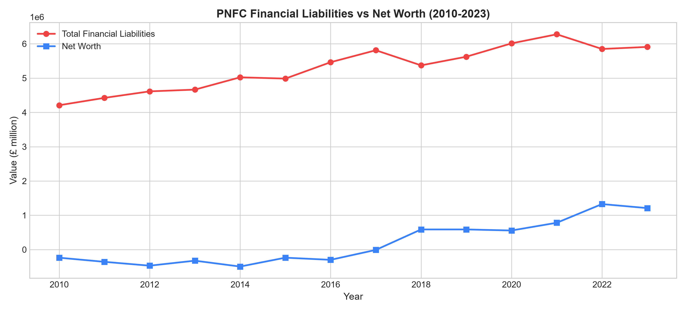
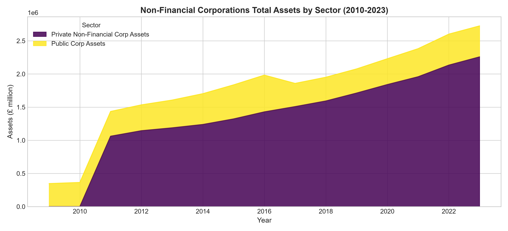
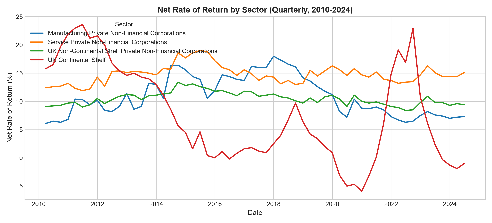
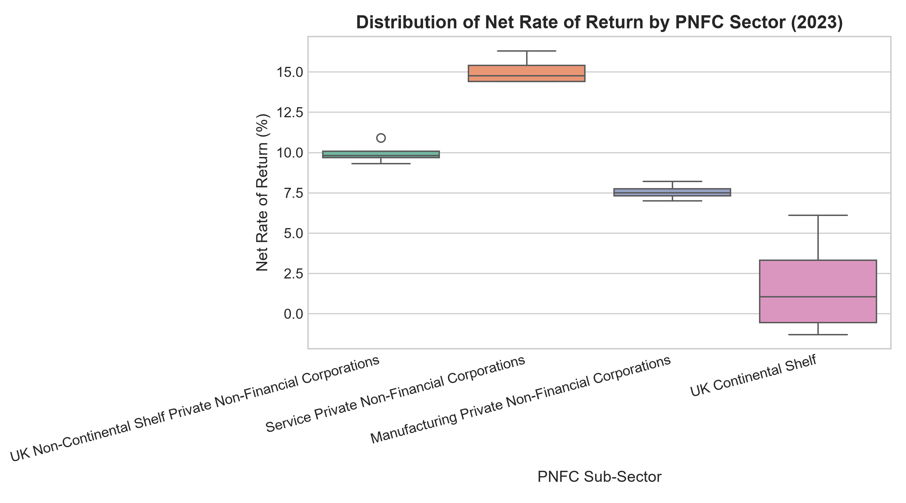
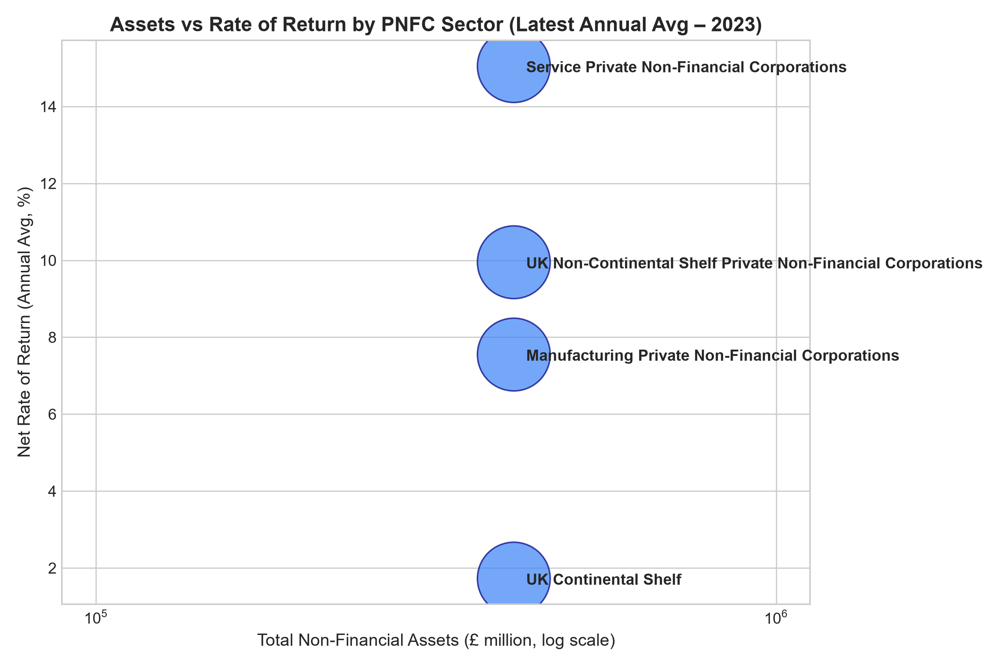
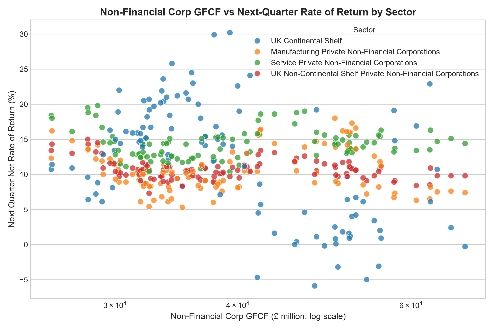
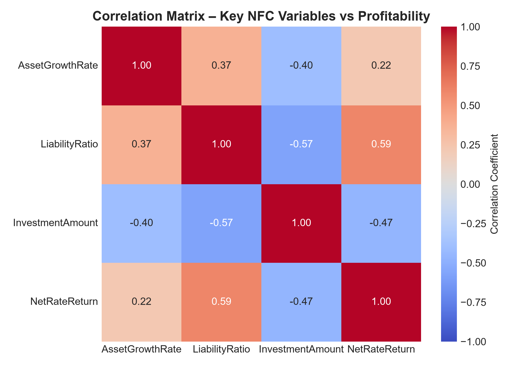
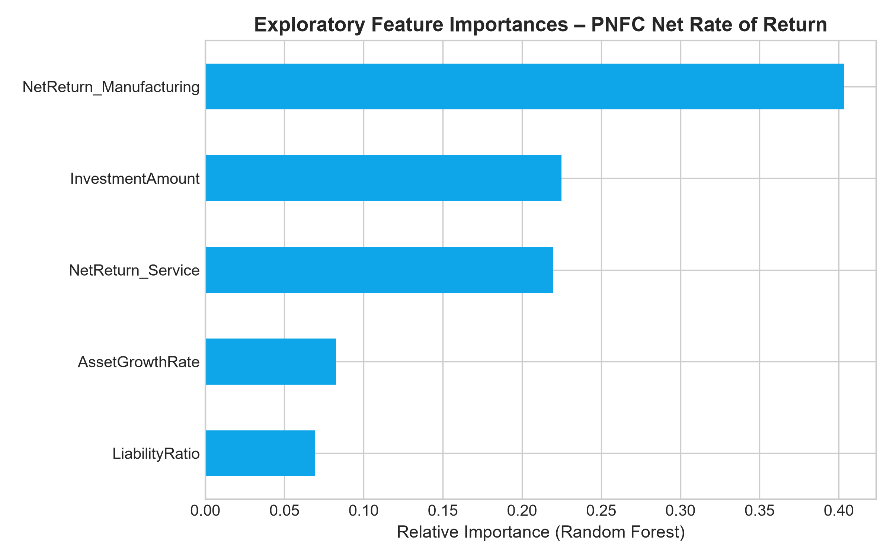

# UK Corporate Balance Sheets & Sectoral Profitability: An Empirical ONS Analysis (2010–2024)

[](https://www.python.org/)
[](https://www.nationalarchives.gov.uk/doc/open-government-licence/version/3/)
[](https://jupyter.org/)

> **Author**: Rafi Uz Zaman Siddiqui  
> **Release**: v1.1.0 (October 2026) | Academic Baseline: v1.0.0 (December 2025)

---

### 📋 Version History
- **v1.1.0 (October 2026)**: Fixed balance-sheet series extraction using official ONS CDID codes (`NG2Y`, `NLBB`, `TMPN`), added MIT license, refreshed figures with verified historical values, and clarified debt vs equity liabilities breakdown.
- **v1.0.0 (December 2025)**: Initial academic baseline submission and exploratory analysis pipeline. *(Note: The v1.0.0 git snapshot was reconstructed on 26 Oct 2026; original git history was overwritten).*

---

## 📌 Executive Summary

Private Non-Financial Corporations (PNFCs) form the productive backbone of the United Kingdom’s economy, generating the vast majority of non-governmental output, employment, and capital investment. However, since the 2008 global financial crisis, UK PNFCs have operated under compounding pressures: post-austerity structural shifts, prolonged low-interest regimes followed by aggressive monetary tightening, volatile global energy markets, and fundamental transformations in corporate debt structure.

Traditional aggregate macroeconomic reports often treat the UK corporate sector as a monolith, masking critical micro-economic divergence across sub-sectors. By conducting an empirical evaluation of **13+ years of official Office for National Statistics (ONS) data (2010–2024)**, this project unmasks the underlying financial determinants of corporate profitability and solvency.

### Core Discoveries:
1. **Balance Sheet Expansion & Net Worth Recovery**: PNFC gross financial liabilities expanded from £4.21T in 2010 to £5.91T in 2023 (+40.4%). Meanwhile, aggregate corporate Net Worth (B.90) transitioned from negative (-£237bn in 2010) into positive territory post-2018, reaching +£1.21T by 2023 as tangible assets grew faster than liabilities.
2. **Sectoral Divergence**: The UK corporate economy exhibits persistent structural divergence between a resilient **Service Sector** (returns oscillating tightly between 11.9% and 19.0%) and a volatile **UK Continental Shelf (UKCS)** extraction sector (spanning from -5.9% to 23.6%).
3. **Asset Stock Dominance**: Private Non-Financial Corporations hold **84% to 91%** of total non-financial corporate tangible capital stock, confirming private sector health dictates macro resilience.
4. **Capital Investment vs Returns**: Pooled correlation between quarterly non-financial corporate GFCF and subsequent-quarter net returns is weak negative ($r = -0.21, n = 848$), illustrating that gross spending volume alone does not dictate near-term profitability uplift.

---

## 🔬 Research Hypotheses & Methodology

The analysis evaluates three primary research hypotheses:
- **$H_1$ (Fragility Hypothesis) — Nuanced / Partly Supported**: While gross financial liabilities expanded to £5.91T, aggregate corporate net worth transitioned into positive territory post-2018 as tangible asset growth outpaced debt additions. Refinancing fragility is concentrated specifically in the ~£1.70T debt-stock component (loans and debt securities) rather than overall corporate equity.
- **$H_2$ (Heterogeneity Hypothesis)**: Return on capital is structurally divergent; service corporations exhibit low volatility while Continental Shelf entities drive cyclical swings.
- **$H_3$ (Investment Efficiency Hypothesis)**: Capital expenditures (GFCF) do not guarantee immediate profitability improvements and exhibit lag or decoupling.

### Methodology & Data Pipeline
- **Data Ingestion**: Multi-table parsing of ONS Quarterly and Annual time series (1997–2024) aligned with official CDID series codes (`NG2Y`, `NLBB`, `TMPN`, `NG2I`, `NONT`, `CGRV`).
- **Time Harmonization**: Standardizing ONS quarterly strings (`YYYY Qx`) to calendar quarter-ends and aligning with annual national balance sheet estimates.
- **Statistical Modeling & Code Quality**: Correlation analysis, sector variance dispersion, and exploratory feature importance modeling within a modular Python package structure.

---

## 📊 Key Findings & Empirical Visualizations

### 1. Insight 1: Financial Liabilities vs Net Worth (2010–2023)
Tracking UK Private Non-Financial Corporation (PNFC) balance sheets via official ONS national accounts series reveals substantial gross liability growth alongside a multi-year recovery in net worth.



- **📊 Visual Guide**: Red line with circles = PNFC Total Financial Liabilities (`NLBB`, £ million); Blue line with squares = PNFC Net Worth (`TMPN`, B.90, £ million) over 2010–2023.
- **🔍 Empirical Observation**: Gross financial liabilities grew from £4,208,712m (£4.21T) in 2010 to £5,908,868m (£5.91T) in 2023 (+40.4%). Net worth started at -£236,693m (-£237bn) in 2010, crossed into positive territory in 2018 (+£587bn), was +£556,569m (+£557bn) in 2020, and reached £1,209,585m (+£1.21T) in 2023 as non-financial assets grew faster than liabilities.
- **💡 Strategic Takeaway**: Of the £5.91T total financial liabilities, ~65% (£3.84T) consists of equity and investment fund shares, while loans and debt securities represent an actual debt stock of ~£1.70T (29%). It is this £1.7T debt stock that bears direct sensitivity to interest-rate refinancing cycles.

---

### 2. Insight 2: Private Sector Asset Stock Dominance
Evaluating non-financial balance sheet asset shares confirms that Private Non-Financial Corporations hold the overwhelming majority of productive tangible assets.



- **📊 Visual Guide**: Stacked area chart showing tangible non-financial asset stock (£ million) split between Private Non-Financial Corporations (PNFCs, `NG2Y`) and Public Non-Financial Corporations (`NG2Q`).
- **🔍 Empirical Observation**: PNFCs consistently account for **84% to 91%** of total non-financial corporate capital stock over the 2010–2023 period (rising to 90.2% by 2023 at £4.28T vs £468bn for public corporations).
- **💡 Strategic Takeaway**: Macro corporate strategy and systemic solvency assessments must center on private corporate balance sheets, as public non-financial corporations maintain a relatively small and stationary asset base.

---

### 3. Insight 3: Sectoral Profitability Divergence
Longitudinal analysis of the Net Rate of Return (%) across UK sub-sectors illustrates sharp structural divergence between services and extraction:



- **📊 Visual Guide**: Multi-line quarterly time series (2010–2024) tracking Net Rate of Return (%) across Service PNFCs, Manufacturing PNFCs, UK Continental Shelf (UKCS), and All PNFCs aggregate.
- **🔍 Empirical Observation**: The **Service Sector** acts as a stabilizing economic core, maintaining returns between **11.9% and 19.0%** (mean: 14.8%). In contrast, the **UK Continental Shelf** exhibits extreme cyclical volatility, swinging between a low of **-5.9%** and a peak of **23.6%** (mean: 7.6%).
- **💡 Strategic Takeaway**: Aggregate UK corporate returns mask wide micro-sector dispersion. Investors and corporate planners must treat the service sector as a reliable cash-flow anchor while actively hedging extractive commodity volatility.

---

### 4. Insight 4: Quantifying Risk & Return Dispersion
Evaluating quarterly return variance for the latest complete fiscal year highlights the difference in predictability across corporate sectors:



- **📊 Visual Guide**: Box-and-whisker plot displaying quarterly return dispersion across sub-sectors. The central line shows the median, the box spans the interquartile range (IQR), and whiskers indicate min/max quarterly observations.
- **🔍 Empirical Observation**: Services exhibit a tight interquartile range with minimal spread, whereas the Continental Shelf and manufacturing sectors display wider quarterly variability.
- **💡 Strategic Takeaway**: Simple arithmetic mean returns are incomplete without variance metrics. Risk frameworks should apply sector-specific discount rates that account for cyclical downside risks.

---

### 5. Insight 5: Asset Base vs Profitability (Risk-Weighted)
Mapping Total Non-Financial Assets against the Net Rate of Return—weighted by the liability-to-asset ratio—examines the link between asset scale and profitability.



- **📊 Visual Guide**: Scatter plot mapping Total Non-Financial Assets (£ million, log scale) against Net Rate of Return (%, vertical axis), with bubble size proportional to the Liability-to-Asset ratio.
- **🔍 Empirical Observation**: Higher asset scale does not automatically equate to higher rates of return. Sub-sectors with smaller asset bases often carry elevated leverage ratios relative to their size.
- **💡 Strategic Takeaway**: Raw scale is not a substitute for capital productivity; managing leverage ratios and operating efficiency is paramount across all enterprise tiers.

---

### 6. Insight 6: Capital Investment (GFCF) vs Profitability
Evaluating whether higher capital spending translates directly into immediate return improvements:



- **📊 Visual Guide**: Scatter plot pairing quarterly capital expenditure (GFCF, £ million, log scale) against Next Quarter Net Rate of Return (%) across sub-sectors.
- **🔍 Empirical Observation**: The pooled correlation across sectors is weak negative ($r = -0.21, n = 848$), demonstrating that aggregate investment volume does not yield a linear, immediate uplift in next-quarter returns.
- **💡 Strategic Takeaway**: Disproves simplistic "spend-to-profit" assumptions. Corporate leadership should evaluate capex through the lens of capital efficiency, gestation lags, and demand-cycle timing rather than gross expenditure targets.

---

### 7. Insight 7: Macro Correlation Matrix
Multi-variable correlation analysis across aggregate UK non-financial corporate balance sheet and profitability series:



- **📊 Visual Guide**: Heatmap of Pearson correlation coefficients across annual corporate variables: Asset Growth Rate, Liability Ratio, Investment Amount, and Net Rate of Return.
- **🔍 Empirical Observation**: The annual Liability Ratio correlates positively with Net Rate of Return ($r \approx 0.45$), reflecting debt-leveraged return amplification during expansion phases, while annual GFCF investment correlates negatively with the net return rate ($r \approx -0.47$).
- **💡 Strategic Takeaway**: Leverage amplifies returns during expansionary periods, but heightened liability ratios simultaneously increase balance sheet vulnerability when debt refinancing costs rise.

---

### 8. Insight 8: Exploratory Feature Importance
Decomposing relative feature weights in predicting aggregate corporate net return:



- **📊 Visual Guide**: Horizontal bar chart showing relative feature importances from a Random Forest regressor fitted across available annual macro and sector return variables.
- **🔍 Empirical Observation**: Sub-sector performance indicators (Service and Manufacturing return rates) and liability ratios account for the majority of in-sample explanatory weight, ranking above aggregate top-line asset growth rates.
- **💡 Strategic Takeaway**: Illustrates that micro-sector health and capital structure metrics provide stronger informational signals for profitability modeling than broad aggregate asset expansion.

---

## 🎯 Strategic & Policy Recommendations

1. **Corporate Capital Allocation**:
   - **Overweight Services**: Direct strategic investment toward service-oriented operations for dependable cash flows and low volatility.
   - **Hedge Extractive Exposure**: Implement strict financial hedging against Continental Shelf volatility.
2. **Fragility & Solvency Monitoring**:
   - Monitor the **Liability Ratio** ($Total Liabilities / Total Assets$) closely. The widening spread against Net Worth indicates elevated sensitivity to interest rate increases.
3. **Capex Governance**:
   - Abandon blunt "volume-based" capital expenditure targets. GFCF must be paired with operational efficiency and demand-cycle timing rather than assuming spending automatically fuels profitability.

---

## 📁 Repository Structure

```text
uk-leverage-paradox-analysis/
├── data/                                 # ONS reference datasets & documentation
│   └── README.md                         # Data dictionary and ONS source citations
├── figures/                              # High-resolution generated empirical figures
│   ├── chart1_profitability_trend.png
│   ├── chart2_asset_vs_return.png
│   ├── chart3_correlation_matrix.png
│   ├── chart4_sector_assets_stacked.png
│   ├── chart5_return_distribution_boxplot.png
│   ├── chart6_liabilities_vs_networth_paradox.png
│   ├── chart7_investment_vs_future_return.png
│   └── chart8_rf_feature_importance.png
├── scripts/                              # Verification and batch automation scripts
│   ├── generate_figures.py               # Generates all publication-quality chart figures
│   └── test_pipeline.py                  # Integration tests for ONS data extraction
├── src/                                  # Core modular Python package
│   ├── __init__.py                       # Package initialisation & metadata
│   ├── data_loader.py                    # ONS Quarterly & Annual spreadsheet parsers
│   ├── model.py                          # Random Forest machine learning pipeline
│   └── visualizations.py                 # Matplotlib / Seaborn visualization routines
├── 2024q2referencetables.xlsx            # ONS Profitability reference tables
├── Financial_Analysis_Charts.ipynb       # Interactive Jupyter analysis notebook
├── nbsreferencetables2024.xlsx           # ONS National Balance Sheet estimates
├── ukea2023q2table2corpssectorv2.xlsx    # ONS UK Economic Accounts - S.11 Capital
├── LICENSE                               # MIT License
├── requirements.txt                      # Project Python dependencies
└── .gitignore                            # Git exclusion rules
```

---

## 🚀 Getting Started

### Prerequisites
- Python 3.10, 3.11, or 3.12
- Git

### Installation
1. Clone this repository:
   ```bash
   git clone https://github.com/rafiuzzamans/uk-leverage-paradox-analysis.git
   cd uk-leverage-paradox-analysis
   ```

2. Create and activate a virtual environment:
   ```bash
   python -m venv venv
   # On Windows:
   .\venv\Scripts\activate
   # On macOS/Linux:
   source venv/bin/activate
   ```

3. Install required packages:
   ```bash
   pip install -r requirements.txt
   ```

4. Verify data ingestion:
   ```bash
   python scripts/test_pipeline.py
   ```

5. Launch the interactive Jupyter notebook:
   ```bash
   jupyter notebook Financial_Analysis_Charts.ipynb
   ```

6. Or re-generate all publication figures:
   ```bash
   python scripts/generate_figures.py
   ```

---

## 📚 References & Data Sources

1. **Office for National Statistics (ONS)** (2024). *Profitability of UK companies reference tables (2024 Q2)*. [ONS Dataset Reference](https://www.ons.gov.uk/economy/nationalaccounts/uksectoraccounts/datasets/profitabilityofukcompaniesreferencetable)
2. **Office for National Statistics (ONS)** (2024). *The National Balance Sheet estimates (2024 Release)*. [ONS Dataset Reference](https://www.ons.gov.uk/economy/nationalaccounts/uksectoraccounts/datasets/thenationalbalancesheetestimates/current)
3. **Office for National Statistics (ONS)** (2024). *UK Economic Accounts: Financial and non-financial corporations sector (2023 Q2)*. [ONS Dataset Reference](https://www.ons.gov.uk/economy/nationalaccounts/uksectoraccounts/datasets/ukeconomicaccountsfinancialandnonfinancialcorporationssector/current)
4. **Siddiqui, Rafi Uz Zaman** (2025). *UK Corporate Balance Sheets & Sectoral Profitability: An Empirical ONS Analysis (2010–2024)*. Project Research Report.

---

## 📄 License
This project codebase and analysis scripts are licensed under the [MIT License](LICENSE).  
Underlying UK public sector reference datasets are published by the Office for National Statistics (ONS) under the [Open Government Licence v3.0 (OGL v3.0)](https://www.nationalarchives.gov.uk/doc/open-government-licence/version/3/).
